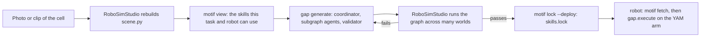

# Motif

**Open robot skills, composed into policy graphs.**

<p align="center">
  
</p>

A robot policy written as a [graph-as-policy](https://github.com/graph-robots/graph-as-policy)
(gap) graph is a few subgraphs wired by their exits: perceive the object,
grasp it, check the grasp, carry it. Each subgraph is built from a **skill**,
and how good the graph is depends on which skills the coordinator had to
choose from. Motif is that set of skills: one catalog anyone can contribute
to, checked against the engine that runs it, and pinned end to end so a graph
that passed in simulation runs on the real arm with exactly the code and
weights it was tested with.

- **Federated.** Bundles from other registries are pinned by commit, not
  copied (`sources.yaml`). Today that is
  [open-robot-skills](https://github.com/graph-robots/open-robot-skills): 8
  tools, 33 skills, 2 policies, plus this repository's own.
- **Checked by the engine.** `motif check` runs gap's own SKILL.md parser and
  validator, then the hub's rules on top.
- **Robot-aware.** Every bundle says which robots it is declared for and
  whether it reads simulator ground truth; a policy also names the action
  space, state and cameras its checkpoint was trained with (`io`). A search
  for a real YAM arm never offers a skill that can only run in simulation, or
  a checkpoint trained on another robot.
- **Pinned.** Weights live on the Hugging Face Hub at an immutable commit with a
  content digest. `skills.lock` records every bundle a graph uses, by commit
  and digest. `motif fetch` rebuilds exactly that on the robot, or refuses.

## Quickstart

```bash
uv sync --extra gap
uv pip install --no-deps "graph-as-policy @ git+https://github.com/graph-robots/graph-as-policy@09e45f8de27bc1a29629382ed7c2b9b4b384b3d6"

uv run --no-sync motif sync        # clone the pinned sources and engine into .motif/
uv run --no-sync motif check       # every bundle, overlay, recipe, paper: 0 errors
uv run --no-sync motif search "put the red block into the bowl" --embodiment yam_i2rt --arms 1
```

The last command ranks the catalog for that task on a one-armed YAM. It drops
what cannot run there (simulator-only and two-arm skills, LIBERO policies) and
says why with `--why`, keeps the best skill per stage, adds the tool bundles
those skills call, and offers the `pick-place-camera-only` recipe. Chinese
instructions work too: the task family is read from either language.

## From a photo to a running arm



```bash
# 1. The coordinator sees only what this task and robot can use.
motif view "put the red block into the bowl" --embodiment yam_i2rt --arms 1 --out views/task
export GAP_SKILLS_PATH=$PWD/views/task      # gap reads it; RECIPES.md goes into the instruction

# 2. After the graph passes in simulation: pin it, and refuse it if it cannot leave simulation.
motif lock path/to/graph --deploy           # writes path/to/graph/skills.lock

# 3. On the robot: the same bundles, the same weights, or an error.
motif fetch path/to/graph/skills.lock --dest ~/motif-runtime
```

[docs/how-gap-runs.md](docs/how-gap-runs.md) walks through what gap does with
these at each step, down to the subprocesses it starts.

## What is in the catalog

| Kind | Lives in | Runs as | Example |
| --- | --- | --- | --- |
| tool | `tools/<name>/` | `@tool` functions, in-process or in their own venv over msgpack RPC | `predicates`, `sam3`, `curobo` |
| skill | `skills/<name>/` | a subgraph the coordinator builds from the skill's SKILL.md and canonical scripts | `grasping-short-axis` |
| policy | `policies/<name>/` | a learned checkpoint behind a websocket server, driven in closed loop | `pi05-libero` |
| recipe | `recipes/<name>/` | a task-level template: which skills, how their exits route | `pick-place-camera-only` |
| paper | `papers/<id>/` | a card linking a method to the bundles that implement it | `curobo-2023` |

Every bundle is a gap bundle, unchanged. What the hub adds sits under
`metadata.hub`, or in an overlay for bundles it federates:
[SPEC.md](SPEC.md).

**Tier** is derived, never declared: a bundle that calls any `sim.*` tool is
`full` and stays in simulation; otherwise it is `camera_only`.
**Maturity** comes from eval records in `evals/`, which only maintainers merge:
`community`, then `sim-verified`, then `real-verified`. Every bundle starts at
`community`.

## Checkpoints on the Hugging Face Hub

```bash
motif new policy yam-pick-cube
motif weights push ./checkpoint --repo <owner>/yam-pick-cube --bundle policies/yam-pick-cube
```

This uploads the folder as one commit and writes
`hf://<owner>/yam-pick-cube@<commit>` and the snapshot's sha256 into the
bundle. The policy server downloads exactly that snapshot and refuses any
other. Git holds the two strings; the Hub holds the gigabytes.

`motif check` rejects the new policy until it also says what it was trained
on: `embodiments` names the robot (never `any`) and `io` gives the action
space and rate, the state and the cameras.

## Layout

```
sources.yaml        engine and upstream registries, pinned by commit
overlays/           hub metadata for federated bundles
tools/ skills/ policies/   this repository's own bundles
recipes/ papers/    task templates and paper cards
evals/              eval records; they set maturity
templates/          what `motif new` copies
src/robomotif/      the `motif` command
```

## Contributing

[CONTRIBUTING.md](CONTRIBUTING.md): adding a tool, skill, policy, recipe or
paper; what review looks for; how an eval record is filed.

## Roadmap

1. **Now:** catalog, checks, search, view, lock, fetch; weights on the Hub.
2. **Evaluation in the loop:** CI runs each bundle's suite in RoboSimStudio on
   GPU runners and files the eval records; badges on every bundle page.
3. **YAM policies end to end:** an observation and action adapter in gap's
   policy loop, so a checkpoint fine-tuned on YAM runs as a policy skill.
4. **A hub site and API** over `index.json`: browse by task, robot and
   maturity; semantic search; per-bundle success rates across robots.
5. **Real-robot verification:** partner cells that run `real-verified` suites.

## License

Apache-2.0. Federated bundles keep the licenses their SKILL.md files declare;
see [NOTICE](NOTICE).
