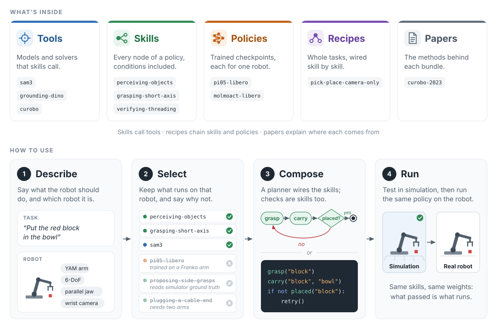
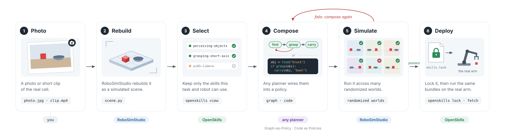

# RoboSkillHub

**An open library of robot skills that any robot policy can build on.**

<p align="center">
  
</p>

Every robot policy is built from the same parts: find the object, grasp it,
check the grasp, carry it. That holds whether the policy is a graph of
subgraphs ([Graph-as-Policy](https://github.com/graph-robots/graph-as-policy)),
a program a language model writes
([Code as Policies](https://code-as-policies.github.io/)), or an agent calling
tools. RoboSkillHub is a shared library of those parts: perception and planning
tools, reusable skills, trained checkpoints, task recipes, and the papers
behind them. Anyone can contribute, every part says which robots it runs on,
and everything is pinned, so a policy that passed in simulation runs on the
real arm with exactly the code and weights it was tested with.

- **Robot-aware.** Every bundle says which robots it is declared for and
  whether it reads simulator ground truth; a policy also names the action
  space, state and cameras its checkpoint was trained with (`io`). A search
  for a real YAM arm never offers a skill that can only run in simulation, or
  a checkpoint trained on another robot.
- **Checked.** `roboskillhub check` validates every bundle, recipe, paper and
  eval record. With Graph-as-Policy installed it runs that engine's validator
  as well.
- **Pinned.** Weights live on the Hugging Face Hub at an immutable commit with a
  content digest. `skills.lock` records every bundle a policy uses, by commit
  and digest. `roboskillhub fetch` rebuilds exactly that on the robot, or
  refuses.
- **Complete.** The 8 tools, 33 skills and 2 policies of
  [open-robot-skills](https://github.com/graph-robots/open-robot-skills) live
  here in this format, next to this repository's own.
  [CATALOG.md](CATALOG.md) lists every one on a page: what it does, what goes
  in and comes out, what each exit means, and what it calls.

## Quickstart

Looking for additional upstream implementations to adapt? The
[reviewed source-intake catalog](candidates/README.md) records exact entrypoints,
licenses, hardware assumptions and adaptation work. `roboskillhub discover "抓取"`
searches that material; `roboskillhub search` below searches the executable bundle
registry. Source candidates are not automatically installed or callable skills.

```bash
uv sync --extra gap
uv run --no-sync roboskillhub check     # every bundle, recipe, paper: 0 errors
uv run --no-sync roboskillhub search "put the red block into the bowl" --embodiment yam_i2rt --arms 1
```

The last command ranks the library for that task on a one-armed YAM. It drops
what cannot run there (simulator-only and two-arm skills, LIBERO policies) and
says why with `--why`, keeps the best skill per stage, adds the tools those
skills call, and offers the `pick-place-camera-only` recipe. A bundle with eval
records on the asked robot ranks higher the more of its episodes succeeded.

When a run fails at one skill, ask for what could replace it or go before it:

```bash
uv run --no-sync roboskillhub search "thread the cable through the ring" --embodiment yam_i2rt \
    --stage execute --failure "the fingertips slid over the cable lying flat and closed on nothing"
```

For `roboskillhub check` to run Graph-as-Policy's validator too, install its
skill loader once:
`uv pip install --no-deps "graph-as-policy @ git+https://github.com/graph-robots/graph-as-policy@09e45f8de27bc1a29629382ed7c2b9b4b384b3d6"`.

## From a photo to a running arm

<p align="center">
  
</p>

```bash
# 1. Only what this task and robot can use: a directory of SKILL.md bundles, plus RECIPES.md.
roboskillhub view "put the red block into the bowl" --embodiment yam_i2rt --arms 1 --out views/task

# 2. Hand it to the planner. Graph-as-Policy reads it from GAP_SKILLS_PATH;
#    a code-as-policies prompt can list the same SKILL.md files.
export GAP_SKILLS_PATH=$PWD/views/task

# 3. After the policy passes in simulation: pin it, and refuse it if it cannot
#    leave simulation. (lock reads a Graph-as-Policy graph directory today.)
roboskillhub lock path/to/graph --deploy      # writes path/to/graph/skills.lock

# 4. On the robot: the same bundles, the same weights, or an error.
roboskillhub fetch path/to/graph/skills.lock --dest ~/roboskillhub-runtime
```

## Runtimes and simulators

RoboSkillHub holds the parts; a runtime runs the policy, in a simulator or on
the robot.

The first five station-bound capabilities now have a direct agent API:
`roboskillhub runtime list`, `runtime invoke` and local JSON-lines `runtime serve`.
They cover measured pose movement, grasp-and-lift, point tracking, planar pushing
and drawer pulling. [Workcell setup and contracts](docs/workcell-runtime.md)
explain the versioned YAM TCP bridge, live RGB-D observation and Isaac Core
adapter. Live camera tracking, model-only YAM protocol/IK, and isolated Isaac 6.2
YAM movement, pushing, grasp-and-lift and drawer pulling have been exercised.
The contact scenes use refined fingertip collision geometry; the drawer is a
controlled prismatic fixture. Hardware manipulation still requires the team's
target-specific workcell tests.

- **Graph-as-Policy** loads every bundle as it is.
  [docs/how-gap-runs.md](docs/how-gap-runs.md) walks through what it does
  with them at each step, down to the subprocesses it starts.
- **[Code as Policies](https://code-as-policies.github.io/) and agent tool
  lists.** Tools are typed Python functions, each with a JSON schema, so a
  generated program or an agent can call them directly. The workcell runtime
  exposes the first five capabilities as schemas plus a common invoke API.
- **Any simulator.** A skill reaches the world only through `robot.*` tools,
  and `sim.*` ground-truth tools in simulation. Any simulator that provides
  them can run it, and the same skill then runs on the real arm, where only
  `robot.*` exists. RoboSimStudio provides them today. The new workcell bundles
  use their own explicit YAM/Isaac station adapters; those do not provide the
  entire legacy `robot.*` connector API. MuJoCo remains a separate integration.

## What is in the library

Browse it at **[runtime-si.github.io/RoboSkillHub](https://runtime-si.github.io/RoboSkillHub/)**: every bundle
searchable by task, stage and robot, with a page each saying what goes in and comes out, what each exit means and
what it calls. The site is generated from this repository by `roboskillhub site --out _site` and rebuilt from main
on every push.

| Kind | Lives in | What it is | Example |
| --- | --- | --- | --- |
| tool | `tools/<name>/` | typed Python functions, in-process or in their own environment over RPC | `predicates`, `sam3`, `curobo` |
| skill | `skills/<name>/` | any node of a policy, conditions included: a SKILL.md a planner reads, the scripts it runs, and named exits to branch on | `grasping-short-axis`, `verifying-placement` |
| policy | `policies/<name>/` | a learned checkpoint behind a websocket server, driven in closed loop | `pi05-libero` |
| recipe | `recipes/<name>/` | a task-level template: which skills, how their exits route | `pick-place-camera-only` |
| paper | `papers/<id>/` | a card linking a method to the bundles that implement it | `curobo-2023` |

**Every node is a skill, conditions included.** Finding the block, putting it
in the bowl, and asking "is it in the bowl?" are all skills. A condition skill
such as `verifying-placement` answers one question, and its exits (`verified`,
`not_placed`) are the branch the policy takes, so the check is written and
tested once instead of inside every graph. Conditions sit at the `verify`
stage, and search offers them next to the actions they check.

Bundles use the Agent Skills `SKILL.md` layout, and the `gap:` block
Graph-as-Policy reads is kept as it is. What RoboSkillHub adds sits under
`metadata.hub`: [SPEC.md](SPEC.md).

```yaml
metadata:
  hub:
    stage: perceive              # perceive, propose, select, plan, execute, verify, ...
    embodiments: [any]           # the robots it is declared for
    tuned_on: [panda]            # where its constants were measured
    tasks: [pick-place]
    version: 0.1.0
    provenance:
      code: https://github.com/graph-robots/open-robot-skills/tree/752dfbd.../skills/perceiving-objects
      upstream_license: MIT
```

**Tier** is derived, never declared: a bundle that calls any `sim.*` tool is
`full` and stays in simulation; otherwise it is `camera_only`.
**Maturity** comes from eval records in `evals/`, which only maintainers merge:
`community`, then `sim-verified`, then `real-verified`. Every bundle starts at
`community`.

## Checkpoints on the Hugging Face Hub

```bash
roboskillhub new policy yam-pick-cube
roboskillhub weights push ./checkpoint --repo <owner>/yam-pick-cube --bundle policies/yam-pick-cube
```

This uploads the folder as one commit and writes
`hf://<owner>/yam-pick-cube@<commit>` and the snapshot's sha256 into the
bundle. The policy server downloads exactly that snapshot and refuses any
other. Git stores only the URI and the digest; the weights stay on the Hub.

`roboskillhub check` rejects the new policy until it also says what it was
trained on: `embodiments` names the robot (never `any`) and `io` gives the
action space and rate, the state and the cameras.

## Layout

```
tools/ skills/ policies/   every bundle, one directory each
recipes/ papers/    task templates and paper cards
evals/              eval records; they set maturity
candidates/         read-only index of upstream sources (`roboskillhub sources`); never bundles
CATALOG.md          every bundle on one page, written by `roboskillhub catalog`
.github/workflows/  the website: `roboskillhub site` rebuilds it from main on every push
tests/              the hub's tests; tests/bundles/ holds the bundles' own
templates/          what `roboskillhub new` copies
src/roboskillhub/   the `roboskillhub` command
sources.yaml        the validator's engine, and any federated registry, pinned by commit
```

## Contributing

[CONTRIBUTING.md](CONTRIBUTING.md): adding a tool, skill, policy, recipe or
paper; what review looks for; how an eval record is filed.

## Roadmap

1. **Now:** library, checks, search, view, lock, fetch; weights on the Hub.
2. **More runtimes and simulators:** tools and skills exposed as plain
   functions for code-as-policies programs and agent tool lists, next to
   Graph-as-Policy; connectors for Isaac Sim and MuJoCo, next to RoboSimStudio.
3. **Evaluation in the loop:** CI runs each bundle's suite in simulation on
   GPU runners and files the eval records; badges on every bundle page.
4. **YAM policies end to end:** an observation and action adapter in the
   policy loop, so a checkpoint fine-tuned on YAM runs as a policy.
5. **A site and API** over `index.json`: browse by task, robot and maturity;
   semantic search; per-bundle success rates across robots.
6. **Real-robot verification:** partner cells that run `real-verified` suites.

## License

Apache-2.0. Each bundle keeps the license its SKILL.md declares (Apache-2.0 or
MIT); see [NOTICE](NOTICE).
